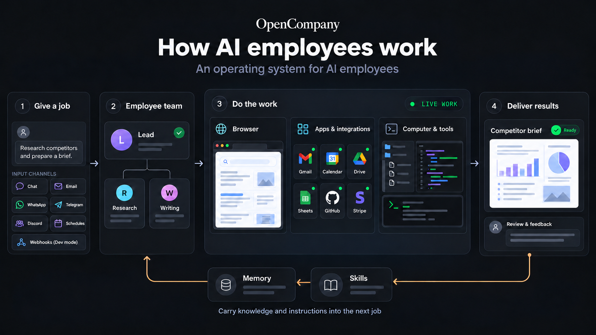

# OpenCompany

<a href="https://www.npmjs.com/package/@zeenie-ai/opencompany" target="_blank"></a>
<a href="https://opensource.org/licenses/MIT" target="_blank"></a>
<a href="https://discord.gg/c9pCJ7d8Ce" target="_blank"></a>
<a href="https://deepwiki.com/zeenie-ai/OpenCompany" target="_blank"></a>

**Self-improving AI employees, running on your own computer.**

OpenCompany is an open-source operating system for AI employees. It gives employees browsers, apps, tools, integrations, and access to your computer to complete work. Hire them to build and ship software, grow your business, answer customers, run operations, or research a topic.

Describe a job in plain words and connect the tools it needs. Each employee has a workspace, a routine, skills, and memory. A lead coordinates specialist AI agents to carry out the job, review their work, and bring you the result. You choose their access and ground rules, watch them work, and coach them as they gain experience and new abilities.

**[Get started](#for-everyone)** · **[For technical readers](#for-technical-readers)** · **[Documentation](https://docs.opencompany.sh)** · **[Discord](https://discord.gg/c9pCJ7d8Ce)**

## For everyone

### What could you hire an employee to do?

Hire employees for roles like these, then adapt their instructions and tools to your work.

| Employee | Example job |
| --- | --- |
| **Builder** | Build software, write and run code, work on pull requests, and use deployment tools. |
| **Grower** | Research the market, create content, publish to connected channels, and manage community conversations. |
| **Chief of Staff** | Manage email, calendars, documents, and tasks, and bring you a daily briefing. |
| **Front Desk** | Answer customer questions, help with booking requests, and bring you cases that need your attention. |
| **Researcher** | Browse the web, read documents, investigate a topic, and organize the findings. |
| **Treasurer** | Track payment events and help manage payment operations through connected services. |

These are roles you can configure. Home also offers four starter jobs: **Receptionist**, **Inbox assistant**, **Social media helper**, and **Daily briefer**. Pick one or describe your own. What an employee can do depends on the apps, tools, AI model, and instructions you give it.

### Get started

Download and install the desktop app from the [latest release](https://github.com/zeenie-ai/OpenCompany/releases/latest):

| Your computer | Download |
| --- | --- |
| Windows | [Windows installer](https://github.com/zeenie-ai/OpenCompany/releases/latest/download/OpenCompany-windows-x64.exe) |
| macOS, Apple Silicon | [Mac installer](https://github.com/zeenie-ai/OpenCompany/releases/latest/download/OpenCompany-macos-arm64.dmg) |
| Linux | [AppImage](https://github.com/zeenie-ai/OpenCompany/releases/latest/download/OpenCompany-linux-x86_64.AppImage) or [Debian / Ubuntu package](https://github.com/zeenie-ai/OpenCompany/releases/latest/download/OpenCompany-linux-amd64.deb) |

The app downloads its supporting software on first launch, then opens Home.

1. **Connect an AI model.** Follow the prompt in Home or open **Settings > Connectors**. Use an AI provider account or connect a model running on your computer.
2. **Describe the job.** For example: “Read my new emails, draft short replies in my style, and ask me before sending.”
3. **Review the setup.** Check the employee's instructions, apps, routine, and ground rules. Ask for changes and connect any required apps.
4. **Hire.** OpenCompany creates the employee and its team. Work starts once the required connections are ready; its page tells you if something is missing.
5. **Work together.** Chat with the employee, follow its progress, review drafts, and open its Workspace to see reports and files.

You can hire and manage employees from Home without writing code. **Dev mode** opens the visual editor for people who want to customize how a team is put together.

The builds are not code-signed yet. If your computer blocks the installer, macOS provides **System Settings > Privacy & Security**, and Windows SmartScreen provides **More info > Run anyway**.

### How an employee works

[](docs/diagrams/how-ai-employees-work.png)

Jobs can arrive through Home chat, email (Gmail, Outlook, or IMAP), WhatsApp, Telegram, or Discord, or start on a schedule. Dev mode also supports webhook inputs.

An employee takes a job through the steps needed to complete it: browsing websites, using connected apps, working with files, running code, and coordinating specialists. Its lead assigns work and reviews submissions. You can see progress, results, and requests for help on the employee's page.

**You set the ground rules.** New hires ask before sending by default. Supported send actions appear as drafts for approval; browser use is restricted to reading while Ask first is on. You can review app-access requests, change access, and stop or resume the employee from Home. Keep the app running and your computer awake for background work.

**You can watch and help.** The Workspace shows work on a canvas, in a browser, or on an Android screen. Take over the browser to sign in or help, then hand control back. The optional Android workspace currently runs on Windows x64; see the [mobile guide](docs/mobile-workspace.md).

### How employees get better at their jobs

- **Memory:** With memory enabled, employees can save useful facts, preferences, and decisions for later work.
- **Coaching:** Give feedback in chat and refine the employee's instructions as you see results.
- **Skills:** A skill is a written playbook, such as how to answer customers or prepare your weekly report. **Settings > Skills** manages the library used by new hires; existing employees can be given skills through chat.
- **New abilities:** Ask an employee to add a tool or skill within its access rules. Use **Apply** to activate saved changes for future work; the change takes effect once its current work finishes.

This is how employees improve: saved knowledge, clearer instructions, and better tools. OpenCompany does not retrain the underlying AI model.

### Browsers, apps, tools, and your computer

Employees combine the capabilities a job needs:

- **Browser:** Research websites and work in web apps, with a live browser view where you can watch and take over when needed.
- **Apps and integrations:** Work with email, calendars, documents, spreadsheets, messaging, payments, and development services. Connections include Google Workspace, Microsoft 365, WhatsApp, Telegram, Discord, X, Stripe, GitHub, Vercel, Cloudflare, and Google Cloud.
- **Computer and tools:** Read and write files, write and run code, use the terminal, manage running programs, search the web, and work with a knowledge base. Speech and translation tools support work across languages.

Connect the services a job needs in **Settings > Connectors**, then choose which apps and tools the employee can use to get the work done.

### Your computer, your choice of AI

The desktop app keeps employee data and encrypted local credentials on your computer. Work sent to a cloud AI provider or a connected service is processed by that service. You can also connect local AI through Ollama or LM Studio.

OpenCompany is open source. Bring your own AI provider keys or use a local model; provider and connected-service charges and limits still apply. A local model uses your computer's hardware.

### See it in action

**Hiring your first employee, end to end ↓**

https://github.com/user-attachments/assets/a5a5583f-bb5f-4d27-a387-8522c556e89e

**An employee adding the tools it needs, mid-task ↓**

https://github.com/user-attachments/assets/035a2293-0837-4969-8b9d-8d680e023b89

**A lead running its team ↓**

https://github.com/user-attachments/assets/3d25e9a3-f7b9-4760-8b9a-6de1e5a19cad

## For technical readers

### Run from source

Requires **Bun 1.4+** and **Python 3.12**. The build command installs dependencies and prepares the application.

```bash
git clone https://github.com/zeenie-ai/OpenCompany.git
cd OpenCompany
bun install
bun run build
bun run dev
```

See [Setup](docs-internal/SETUP.md), the [scripts reference](docs-internal/SCRIPTS.md), and [CONTRIBUTING.md](CONTRIBUTING.md) for development and validation commands.

### Install on a server

For macOS or Linux:

```bash
curl -fsSL https://opencompany.sh/install.sh | bash
company start
```

For Windows PowerShell:

```powershell
iwr -useb https://opencompany.sh/install.ps1 | iex
company start
```

The installer provisions Bun, Python, and uv when missing, then installs `@zeenie-ai/opencompany`. Open the URL printed by the CLI (the default app URL is http://localhost:5678). Data defaults to `~/.opencompany`, shared with the desktop app; source development uses the repository's `.opencompany` directory. See [Setup](docs-internal/SETUP.md) for configuration and [.env.template](.env.template) for environment variables.

### Self-host with Docker

```bash
git clone https://github.com/zeenie-ai/OpenCompany.git
cd OpenCompany
docker compose up -d --build
```

Compose builds one container from source, persists state in the `opencompany-selfhost_data` volume, and publishes the app on the host's loopback interface. Open the default app URL above and register the owner account. See the [Docker guide](docs-internal/docker.md) for configuration, optional browser dependencies, and authentication.

### How the employee OS is built

OpenCompany's employee OS brings together the runtime, workspaces, browser access, app integrations, tools, memory, and skills employees need to complete jobs. The React interface offers Home for hiring and daily work, plus a React Flow editor for configuring teams. The Python backend represents an employee as a workflow containing a lead, specialist agents, tools, conversation context, memory, and skills. Home's hiring flow creates this structure for you.

- **Delegation:** The lead assigns tasks to connected teammates. Task records track assignment, submission, review, and completion. See [employee teams](docs-internal/employee_teams.md) and [agent delegation](docs-internal/agent_delegation.md).
- **Context and memory:** Stored conversations preserve working context; a separate memory tool holds facts an agent chooses to save. Team members have their own context and memory. See [agent context](docs-internal/agent_context_flow.md) and [compaction](docs-internal/memory_compaction.md).
- **Execution:** Temporal supports durable background work, event handling, and schedules. Stop allows admitted work to finish; Resume releases pending work. See [Temporal architecture](docs-internal/TEMPORAL_ARCHITECTURE.md) and [Stop / Resume semantics](docs-internal/temporal-workflow-control.md).
- **Models:** Native provider adapters support cloud services and local models, with named OpenAI-compatible endpoints for other servers. See the [LLM SDK](docs-internal/native_llm_sdk.md).
- **Extensions:** Backend node plugins declare their schemas and behavior; the interface renders their configuration. See the [plugin recipe](server/nodes/README.md) and [plugin system](docs-internal/plugin_system.md).

The editor includes three example workflows: **AI Assistant**, **AI Employee**, and **Claude Assistant**. They are examples to inspect and customize, separate from Home's starter jobs. [View their structure](docs/diagrams/default-workflows.svg).

### Technical documentation

| If you want to… | Start here |
| --- | --- |
| Understand the codebase or contribute | [CONTRIBUTING.md](CONTRIBUTING.md) |
| Extend tools, triggers, or integrations | [Node plugins](server/nodes/README.md) |
| Run the browser and configure its workspace | [Browser runtime](docs-internal/browser.md), [workspace interface](docs-internal/browser_workspace.md) |
| Set up 1Password bindings | [Credential setup and compatibility](docs-internal/onepassword_credentials.md) |
| Deploy browser workers across machines | [Deployment requirements and recovery](docs-internal/browser_agent_deployment.md) |
| Work on the desktop application | [Desktop architecture](docs-internal/desktop_app.md) |
| Explore architecture and source-backed diagrams | [Internal docs](docs-internal/), [diagram index](docs/diagrams/README.md) |
| Use repository guidance for AI-assisted contributions | [CLAUDE.md](CLAUDE.md) |

Further reading: [hosted documentation](https://docs.opencompany.sh/) · [DeepWiki](https://deepwiki.com/zeenie-ai/OpenCompany).

## Contributing

Issues and pull requests are welcome. [CONTRIBUTING.md](CONTRIBUTING.md) has the fork/branch/PR workflow, the repository map, and recipes for adding a node, LLM provider, or skill.

One note on scope: connector and provider lists are kept deliberately narrow. The Apify node runs any actor through its `custom` option, the TikHub node calls any of its endpoints through `call`, and agents reach any OpenAI-compatible server once it is saved as a named endpoint under Credentials — so a new first-class preset needs a reason beyond "my service could be in the dropdown too."

## Community

[Discord](https://discord.gg/c9pCJ7d8Ce) — the fastest way to get help, request features, and follow design discussions.

## License

[MIT](LICENSE) — © 2026 OpenCompany contributors.
