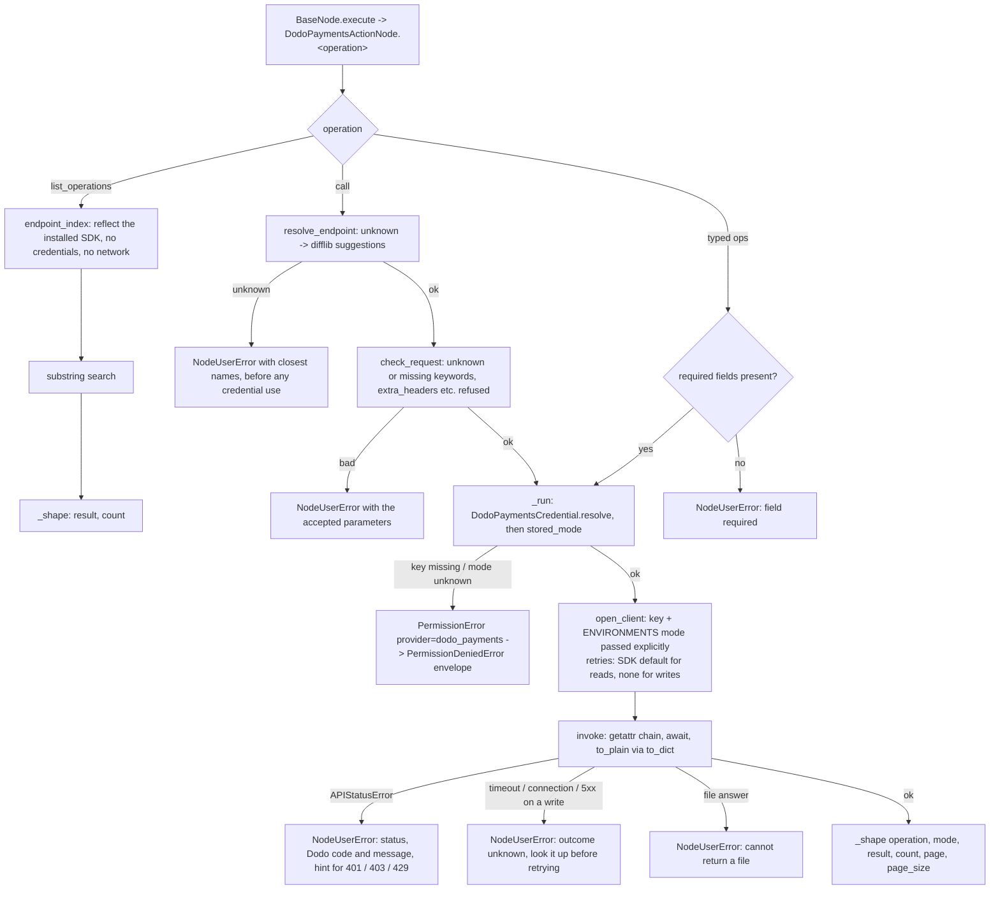

# Dodo Payments (`dodoPaymentsAction`)

| Field | Value |
|------|-------|
| **Category** | payments / tool (dual-purpose) |
| **Backend handler** | [`server/nodes/dodo_payments/dodo_payments_action.py`](../../../server/nodes/dodo_payments/dodo_payments_action.py) - `DodoPaymentsActionNode`; dispatched via `BaseNode.execute()` + the `@Operation("<op>")` methods; SDK glue in [`_sdk.py`](../../../server/nodes/dodo_payments/_sdk.py) |
| **Tests** | [`server/tests/nodes/test_dodo_payments.py`](../../../server/tests/nodes/test_dodo_payments.py) |
| **Skill (if any)** | [`server/skills/payments_agent/dodo-payments-skill/SKILL.md`](../../../server/skills/payments_agent/dodo-payments-skill/SKILL.md) |
| **Dual-purpose tool** | yes - tool name `dodo_payments_action` (`usable_as_tool = True`; both canvas handles explicitly kept visible) |

## Purpose

Take payments and manage billing in Dodo Payments through its official Python
SDK, authenticated by the API key saved in Credentials -> Dodo Payments.
Typed operations cover the everyday flows (payments, subscriptions,
customers, products, refunds, disputes, checkout and customer-portal links,
refunds, cancellations, plan changes); `call` reaches any other SDK method by
its dotted name, and `list_operations` discovers them from the installed SDK
without credentials or network. Used both as a workflow node and as an
AI-agent tool.

## Inputs (handles)

| Handle | Connection type | Required | Purpose |
|--------|-----------------|----------|---------|
| `input-main` | main | no | Upstream data; not consumed directly - all inputs come from `parameters` (or the LLM's tool args when used as a tool) |

## Parameters

(Pydantic `DodoPaymentsActionParams`, `extra="ignore"`; a
`@model_validator(mode="before")` runs `coerce_blank_params(...,
object_fields=("request",))` so the panel's `""` and LLM-stringified JSON both
become a dict.)

| Name | Type | Default | Required | displayOptions.show | Description |
|------|------|---------|----------|---------------------|-------------|
| `operation` | options | `list_payments` | yes (dispatch reads the raw key) | - | `list_payments` / `get_payment` / `list_subscriptions` / `get_subscription` / `list_customers` / `get_customer` / `list_products` / `get_product` / `list_refunds` / `list_disputes` / `create_checkout_session` / `create_customer` / `create_customer_portal_link` / `create_refund` / `cancel_subscription` / `change_subscription_plan` / `call` / `list_operations` |
| `payment_id` | string | `""` | yes for its ops | `get_payment`, `create_refund` | Payment id |
| `subscription_id` | string | `""` | yes for its ops | `get_subscription`, `cancel_subscription`, `change_subscription_plan`, `list_payments`, `list_refunds` | Subscription id; a filter for the two lists |
| `customer_id` | string | `""` | yes for `get_customer`, `create_customer_portal_link` | those, `create_checkout_session` and the payment / subscription / refund / dispute lists | Customer id; on a checkout, an existing customer |
| `product_id` | string | `""` | yes for `get_product`, `create_checkout_session`, `change_subscription_plan` | those, `create_refund`, `list_payments`, `list_subscriptions` | Product id; on a refund, the item refunded |
| `quantity` | int (`ge=1`) | `1` | no | `create_checkout_session`, `change_subscription_plan` | Units |
| `customer_email` | string | `""` | yes for `create_customer` | `create_checkout_session`, `create_customer`, `list_customers` | New customer's email; a filter for `list_customers` |
| `customer_name` | string | `""` | yes for `create_customer` | `create_checkout_session`, `create_customer` | Customer name |
| `return_url` | string | `""` | no | `create_checkout_session`, `create_customer_portal_link` | Where the customer lands afterwards |
| `discount_code` | string | `""` | no | `create_checkout_session` | Sent as `discount_codes: [code]` |
| `amount` | int (`ge=1`) or empty | empty | no | `create_refund` | Part of the item to refund, smallest unit; needs `product_id` |
| `reason` | string | `""` | no | `create_refund` | Refund reason |
| `cancel_at_next_billing_date` | bool | `false` | no | `cancel_subscription` | Keep it until the paid period ends |
| `proration_billing_mode` | options | `prorated_immediately` | no | `change_subscription_plan` | The SDK's five modes |
| `payment_status` / `subscription_status` / `refund_status` | options | `all` | no | their list | The SDK's status values, kept in step by a test |
| `page` | int (`ge=0`) | `0` | no | the six lists | Page number, from 0 |
| `page_size` | int (`1..100`) | `20` | no | the six lists | Items per page |
| `endpoint` | string (dynamic options: `dodoPaymentsEndpoints`) | `""` | yes for `call` | `call` | The SDK method's dotted name (`payouts.list`) |
| `request` | object (JSON editor) | `{}` | no | `call` | The method's keyword arguments |
| `search` | string | `""` | no | `list_operations` | Substring over endpoint names and routes |

Field names `model`, `api_key`, `parameters`, `action`, `service_id` and
`session_id` are deliberately avoided (name-based magic in `ParameterRenderer.tsx`).
The mode is never a parameter: it comes from the credential.

## Outputs (handles)

| Handle | Shape | Description |
|--------|-------|-------------|
| `output-main` | object | `_shape(operation, **fields)` payload (see below); the same payload is returned to the LLM when wired to `input-tools` |
| `output-tool` | - | Auto-appended for `usable_as_tool` |

### Output payload (TypeScript shape)

```ts
// DodoPaymentsActionOutput (extra="allow"); _shape drops only None, so [] / {} results stay
{
  operation: string;
  mode?: "test_mode" | "live_mode";  // every operation that called Dodo
  endpoint?: string;                 // call: the resolved SDK method
  result: unknown;                   // Dodo's own JSON (fields as Dodo sent them); lists: the page's items;
                                     // call on a list endpoint: the page, { items: [...] }
  count?: number;                    // lists and list_operations: items returned
  page?: number;                     // lists
  page_size?: number;                // lists
}
```

## Logic Flow



## Decision Logic

- **Validation**: dispatch requires the `operation` key; each typed op checks
  its required ids before any credential or network use; `create_refund`
  refuses `amount` without `product_id`.
- **Mode**: the credential's saved `dodo_payments_mode` picks the base URL;
  a key without one answers with the `PermissionDeniedError` envelope asking
  to validate it again.
- **Retries**: reads keep the SDK's default retries; writes (every op that
  creates or changes something, and `call` on a non-GET endpoint) run with
  none, because Dodo takes no idempotency key.
- **Approval**: under Ask first, `create_refund`, `cancel_subscription`,
  `change_subscription_plan` and a writing `call` are held as a draft card
  (`ApprovalSpec`, `when` test on the endpoint); everything else runs.
- **Paging**: one page per call; the SDK's auto-pagination is not used.
- **Error paths**: missing credential or mode -> `PermissionDeniedError`
  envelope; SDK `APIError` -> `NodeUserError`; anything else keeps its
  traceback.

## Side Effects

- **Database writes**: none.
- **Broadcasts**: per-node status via `BaseNode.execute`; the credential
  path emits `credential.api_key.runtime_failed` when the key is missing.
- **External API calls**: `https://test.dodopayments.com` or
  `https://live.dodopayments.com` (from the SDK's `ENVIRONMENTS`, by the
  key's mode), bearer-authenticated; `list_operations` makes none.
- **File I/O**: none.
- **Subprocess**: none.

## External Dependencies

- **Credentials**: `DodoPaymentsCredential` (`ApiKeyCredential`, id
  `dodo_payments`): the key under the provider id, plus `dodo_payments_mode`
  (written by validation) and `dodo_payments_webhook_key` (`extra_fields`),
  resolved via `DodoPaymentsCredential.resolve(user_id=ctx.credential_customer_id)`.
  Modal probe: `GET /brands` in test mode, then live mode.
- **Services**: option-loader registry (`dodoPaymentsEndpoints`), the
  approvals subsystem (`services/approvals/`).
- **Python packages**: `dodopayments` (with `httpx`, `pydantic`), imported
  lazily inside `_sdk.py` only.
- **Environment variables**: none. `DODO_PAYMENTS_*` variables never
  authenticate or redirect a node: key and base URL are passed explicitly.

## Edge cases & known limits

- **Webhook endpoints are not reachable** through `call`: the `webhooks`
  resource is left out of the index (secrets have no use in an agent's hands).
- **File answers** (invoice PDFs, payout CSVs) are refused.
- **A held link would be lost**: creating a checkout or portal link is not
  gated, because an approved call's result does not reach the employee.
- **One business per install**: a second key replaces the first.

## Related

- **Skills using this as a tool**: [`dodo-payments-skill/SKILL.md`](../../../server/skills/payments_agent/dodo-payments-skill/SKILL.md)
- **Sibling**: [`dodoPaymentsReceive`](./dodoPaymentsReceive.md); companion payments node [`stripeAction`](../stripe/stripeAction.md)
- **Architecture docs**: [Dodo Payments Service](../../dodo_payments_service.md), [Plugin System](../../plugin_system.md), [Chat Protocol (Approvals)](../../chat_protocol.md)
