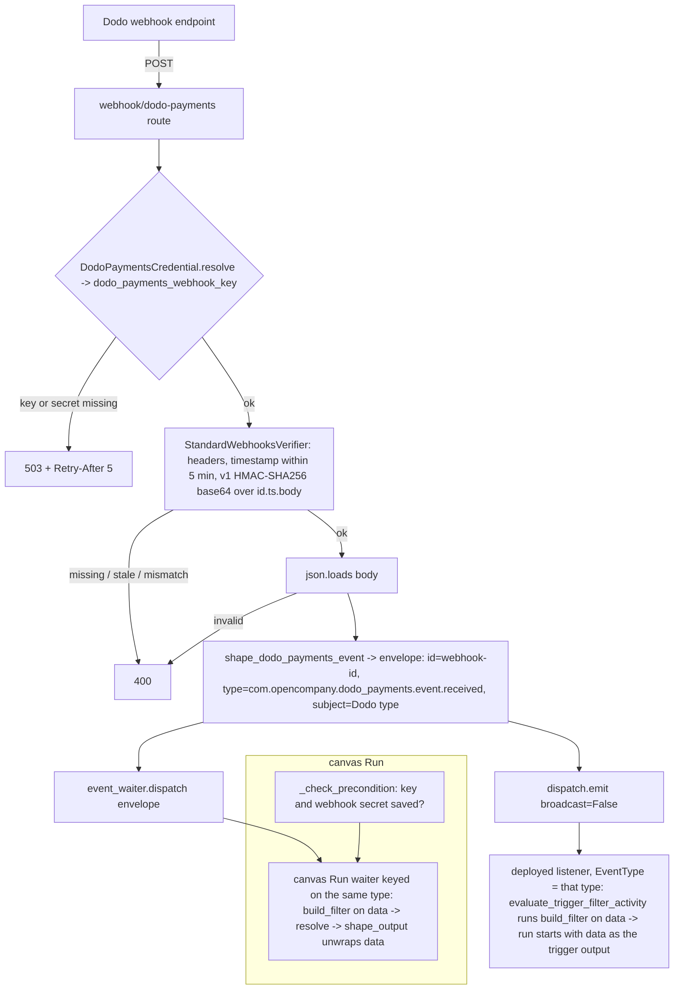

# Dodo Payments Receive (`dodoPaymentsReceive`)

| Field | Value |
|------|-------|
| **Category** | payments / trigger (class `group = ("payments", "trigger")`) |
| **Backend handler** | [`server/nodes/dodo_payments/dodo_payments_receive.py`](../../../server/nodes/dodo_payments/dodo_payments_receive.py) (`DodoPaymentsReceiveNode`, on `WebhookTriggerNode`); webhook plumbing in [`_source.py`](../../../server/nodes/dodo_payments/_source.py) (`DodoPaymentsWebhookSource`, `shape_dodo_payments_event`); the CloudEvents factory and deployed-path emit in [`_events.py`](../../../server/nodes/dodo_payments/_events.py); framework base [`services/events/triggers.py`](../../../server/services/events/triggers.py), [`services/events/webhook.py`](../../../server/services/events/webhook.py), verifier [`services/events/verifiers/standard_webhooks.py`](../../../server/services/events/verifiers/standard_webhooks.py) |
| **Tests** | [`server/tests/nodes/test_dodo_payments.py`](../../../server/tests/nodes/test_dodo_payments.py) |
| **Skill (if any)** | none as a tool (the [dodo-payments-skill](../../../server/skills/payments_agent/dodo-payments-skill/SKILL.md) describes it in prose) |
| **Dual-purpose tool** | no (trigger) |

## Purpose

Fire a workflow when Dodo Payments delivers a webhook event (a payment,
refund, dispute, subscription, payout, license key, credit or dunning event),
on a canvas Run and in a deployed workflow. A webhook endpoint added in the
Dodo dashboard posts to `POST /webhook/dodo-payments`; the source verifies the
Standard Webhooks signature against the endpoint's `whsec_` secret saved in
Credentials -> Dodo Payments, flattens the delivery into the trigger's output
(`shape_dodo_payments_event`), and wraps it in one `WorkflowEvent` type,
`com.opencompany.dodo_payments.event.received`, with Dodo's type in `subject`
and `data.event_type`. It hands that envelope to the in-process event waiter
(a canvas Run, or a deploy that runs without Temporal) and to
`services.events.dispatch.emit` (deployed listeners on Temporal). The node
contributes the event-type filter, the precondition and the output unwrap.

## Inputs (handles)

None - this is a trigger; it is the head of a run.

## Parameters

`DodoPaymentsReceiveParams(BaseTriggerParams)`, `extra="ignore"`.

| Name | Type | Default | Required | displayOptions.show | Description |
|------|------|---------|----------|---------------------|-------------|
| `event_type_filter` | string | `all` | no | - | `all`, an exact Dodo type (`payment.succeeded`), or a `prefix.*` glob (`subscription.*`). Matched against `data.event_type` |

## Outputs (handles)

| Handle | Shape | Description |
|--------|-------|-------------|
| `output-main` | object | `DodoPaymentsReceiveOutput`: the shaped delivery, identical on a canvas Run and in a deployed run |

### Output payload (TypeScript shape)

`extra="allow"`. All fields are `Optional` on the model.

```ts
{
  event_id: string;             // the delivery's webhook-id (the same across Dodo's retries)
  event_type: string;           // Dodo's type, e.g. "payment.succeeded" ("unknown" when missing)
  business_id: string | null;
  timestamp: string | null;     // Dodo's ISO 8601 event time
  payload_type: string | null;  // Payment, Subscription, Refund, Dispute, LicenseKey, ...
  data: object;                 // the payment / subscription / refund / ... itself, {} when missing
}
```

## Logic Flow



## Decision Logic

- **One CloudEvents type**: a deployed trigger listens for exactly one type
  (`register_canary_trigger_type`), so every Dodo event shares it and the
  node sets `event_type` to the same constant, which keys the canvas-Run
  waiter.
- **Two delivery paths**: `WebhookSource.handle` feeds the in-process waiter;
  the source's `handle` override then calls `emit`, the only path to deployed
  listeners on Temporal. The envelope carries no `workflow_id`, so every
  deployment with the trigger receives it.
- **Filter** (`build_filter`): both callers pass the envelope's `data` (an
  envelope is accepted too); `event_type_filter` is matched against
  `data.event_type` with `event_type_matches`; a non-dict payload is rejected.
- **Output**: shaped once, in the source, so a canvas Run and a deployed run
  see the same fields.
- **Precondition** (canvas Run): without the API key, or without the webhook
  secret, the run ends at once with what to save, instead of waiting on
  deliveries that would all get a 503.
- **Verification fails closed**: no secret -> 503 with `Retry-After: 5`;
  missing headers, a timestamp more than five minutes off, or no matching
  `v1,` signature -> 400. Several space-separated signatures are accepted
  (secret rotation).

## Side Effects

- **Event dispatch**: `event_waiter.dispatch` and `dispatch.emit` with
  `broadcast=False` (payment events carry customer details, and no client
  reads them) for every verified delivery.
- **Broadcasts**: none of its own on a canvas Run; a deployed trigger shows
  `waiting` from the deployment manager.
- **HTTP**: `POST /webhook/dodo-payments` answered by the router after
  `handle()`; the source's `receive()` also enqueues the event on its
  internal push queue (nothing consumes that queue for this source).
- **Database writes**: none.

## External Dependencies

- **Credentials**: `DodoPaymentsCredential` (`id = "dodo_payments"`): the
  webhook secret is the `dodo_payments_webhook_key` row; it resolves only
  while the API key is stored too.
- **Services**: Dodo's webhook delivery (up to 8 attempts over about a day),
  which needs a public URL for `/webhook/dodo-payments`.
- **Python packages**: stdlib `hmac` / `hashlib` / `base64`, `fastapi`,
  `pydantic`. The SDK is not used on this path.
- **Environment variables**: none.

## Edge cases & known limits

- `TRIGGER_START_TO_CLOSE` (24 h) bounds the Temporal activity for a canvas
  Run; there is no shorter wait timeout.
- Retried deliveries keep their `webhook-id`, so a deployed listener drops a
  retry as a duplicate; events can arrive out of order, so order by
  `timestamp`.
- Dodo's own `dodo wh trigger` CLI sends unsigned mock events, which this
  source refuses; use the dashboard's Testing tab, which signs them.
- No hire uses `dodoPaymentsReceive` as a trigger yet:
  `config/employee_apps.json` keeps Dodo a tool-only app.

## Related

- **Sibling**: [`dodoPaymentsAction`](./dodoPaymentsAction.md); companion payments trigger [`stripeReceive`](../stripe/stripeReceive.md)
- **Architecture docs**: [Dodo Payments Service](../../dodo_payments_service.md), [Event Waiter System](../../event_waiter_system.md), [Event Framework](../../event_framework.md)
